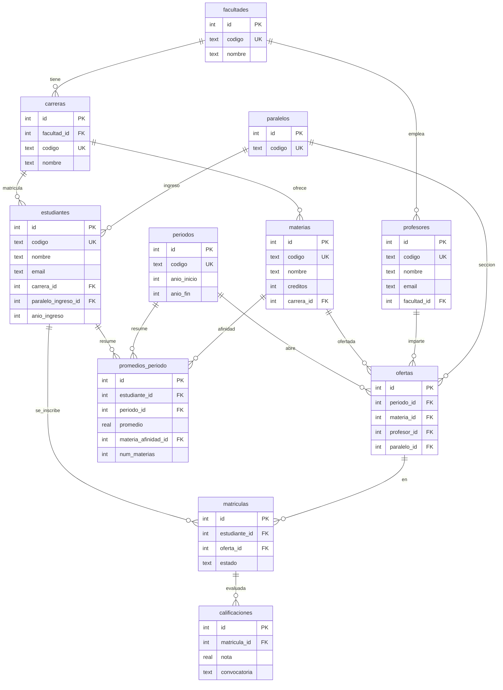

# Esquema ER — BD sintética académica (Ecuador)

Universidad ficticia estilo Quito/USFQ. Escala de notas **0–10**.
Fuente canónica: `estudiantes_sinteticos.json` → migración a `data/negocio_academico.db`.

## Diagrama

Vista renderizada: [`docs/diagramas/er-bd-sintetica-academica.jpg`](../../docs/diagramas/er-bd-sintetica-academica.jpg)

## Tablas

| Tabla | Rol |
|---|---|
| `facultades` | Catálogo de facultades |
| `carreras` | Carreras por facultad |
| `periodos` | 6 años lectivos (p. ej. 2019-2020 … 2024-2025) |
| `paralelos` | Secciones A, B, C |
| `materias` | Catálogo universitario (créditos) |
| `profesores` | Docentes vinculados a facultad |
| `estudiantes` | 500 alumnos sintéticos |
| `ofertas` | Materia + periodo + paralelo + profesor |
| `matriculas` | Estudiante inscrito en una oferta |
| `calificaciones` | Nota 0–10 por matrícula |
| `promedios_periodo` | Promedio y afinidad (materia top) por estudiante/periodo |

## Consultas típicas del SQL Agent

- Top 10 estudiantes por `promedio` en un `periodos.codigo`
- Promedio de notas por `paralelos.codigo` y materia
- Afinidad: `promedios_periodo.materia_afinidad_id` / mejor nota media
- Carga docente: conteo de `ofertas` por profesor
- Evolución de un estudiante a lo largo de los 6 periodos
