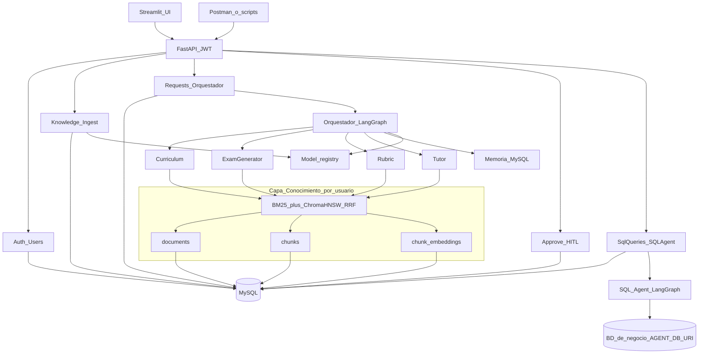
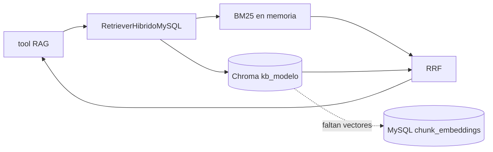
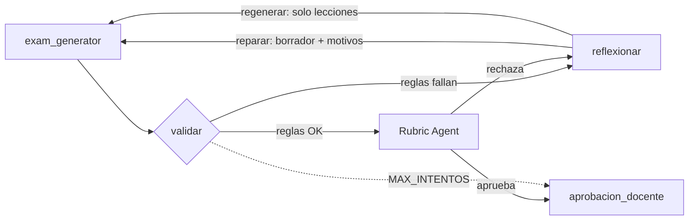
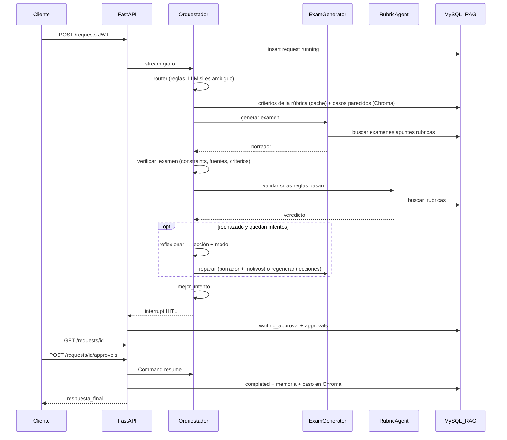

# Asistente IA para Educación — Documento de Arquitectura

Sistema multi-agente (Agentic AI) que asiste a docentes y alumnado, con
**conocimiento RAG privado por usuario**, expuesto mediante **API REST**
autenticada (JWT) y persistido en **MySQL**.

Fundamentos teóricos:

- **Sapkota, Roumeliotis & Karkee (2025), "AI Agents vs. Agentic AI"** (Information Fusion 126):
  taxonomía que distingue AI Agents (sistemas de entidad única, tool-augmented) de Agentic AI
  (ecosistemas orquestados de agentes especializados con descomposición dinámica de tareas,
  memoria persistente y autonomía coordinada).
- **Yang et al. (2025), "A Survey of AI Agent Protocols"** (arXiv:2504.16736): clasificación de
  protocolos de comunicación en contexto-orientados (agente ↔ recursos, p. ej. MCP) e
  inter-agente (agente ↔ agente, p. ej. A2A, ANP), claves para escalar soluciones basadas en agentes.

## 1. Clasificación del sistema

Según la taxonomía de Sapkota et al., este sistema es **Agentic AI**, no un AI Agent aislado:

| Criterio | Este sistema |
|---|---|
| Arquitectura | Múltiples agentes especializados + orquestador (no una entidad única) |
| Descomposición de tareas | El orquestador enruta y descompone la petición en subtareas |
| Memoria | Persistente por usuario (sesión + largo plazo en MySQL) |
| Coordinación | Validación cruzada entre agentes (Rubric revisa a Exam Generator) |
| Autonomía | Coordinada, con human-in-the-loop del docente vía API |
| Multitenancy de conocimiento | Base documental **aislada por `user_id`** |



## 2. Capa de exposición (backend-first)

El camino estable de consumo es la **API REST** (`src/api/`). El cliente de referencia
es Streamlit (`app_streamlit/`), que solo llama HTTP con JWT (sin embeber el grafo ni
el RAG). El CLI (`main.py`) y `src/legacy_chat_api.py` quedan como legado opcional.

| Área | Endpoints | Notas |
|---|---|---|
| Auth | `POST /auth/register`, `/login`, `GET /auth/me` | JWT Bearer; roles `docente` / `alumno` |
| Conocimiento | `/knowledge/...` | CRUD docs + ingest/reprocess scoped al usuario |
| Solicitudes | `POST/GET /requests`, `/approve`, `/events` | Orquestador async + HITL |
| SQL Agent | `POST/GET /sql-queries`, `/events` | Consultas en lenguaje natural a la BD de negocio. Solo `docente` |
| Salud | `GET /health` | Liveness + `llm` del registry |

**UI Streamlit** (`streamlit run app_streamlit/Home.py`): Home (login + CTA), Conocimiento
(indexar / confirmar borrado), Asistente (progreso + approve inline HITL), Historial
(filtros / reanudar), Aprobaciones (contador en menú). Variable `STREAMLIT_API_BASE_URL`.

Aislamiento: **todo filtrado por `user_id` del JWT**. Un usuario no ve documentos,
chunks ni solicitudes de otro.

## 3. Directrices de Orquestación

### 3.1 Patrón supervisor

Un grafo LangGraph actúa como **orquestador supervisor**: recibe la petición, clasifica la
intención (docente o alumno; planificar, examinar, evaluar o tutorizar) y enruta al agente
especializado. Cada agente es un subgrafo con sus propias tools.

- Alumno → siempre `tutor` (regla de salvaguarda, sin LLM en el router).
- Docente → primero reglas deterministas (`src/orchestrator/routing.py`: verbo de acción +
  objeto, p. ej. "genera… examen"); si ninguna o varias coinciden, clasificación LLM
  estructurada (`DecisionRouter`). El evento `router` registra `metodo=regla|llm`.

### 3.2 Ciclo ReAct por agente

Cada agente opera en bucle **ReAct** (razonar → llamar tool → observar → iterar), con
límite de iteraciones (`MAX_ITERACIONES_REACT`) para acotar coste y bucles.

- Si se agota el límite, `ejecutar_agente` devuelve una respuesta controlada
  ("no consta evidencia suficiente") en vez de fallar la solicitud.
- Cada tool RAG anota las fuentes devueltas (evidencia), que el verificador usa para
  rechazar citas inventadas.
- El evento `agente_fin` registra iteraciones, tools y tokens de entrada/salida.

### 3.3 Estado compartido tipado

El estado del grafo transporta: petición, rol, `alumno_id`, agente destino, borradores
legibles y **contratos Pydantic** (`constraints`, `examen` y, por intento, el
`veredicto`) serializados como dict; los campos de Reflexion se describen en §5.4. El LLM
puede cambiar; el routing (p. ej. reflexionar vs HITL) usa campos tipados
(`veredicto.aprobado`), no substrings del texto libre. Si la salida del LLM
no valida, `safe_parse` aplica un fallback seguro para no corromper la solicitud.
En API, el `thread_id` de la solicitud permite
reanudar el HITL entre llamadas HTTP.

### 3.4 Protocolos para escalar

- **MCP (contexto-orientado)**: tools RAG como funciones puras/autodescriptivas, listas para
  servidor MCP. Hoy se invocan in-process con `user_id` en ContextVar.
- **A2A (inter-agente)**: camino de evolución; se mantienen principios de seguridad y tareas
  de larga duración (status `running` / `waiting_approval` / `completed`).

### 3.5 Mitigación de riesgos multi-agente

1. **Validación cruzada híbrida**: todo examen pasa primero por reglas deterministas y,
   si las cumple, por el Rubric Agent. Los rechazos alimentan Reflexion (§5.4).
2. **Límites de iteración** en cada bucle ReAct.
3. **Human-in-the-loop**: `interrupt` → `waiting_approval` → `POST /requests/{id}/approve`.
4. **Trazabilidad**: fuentes citadas + `request_events` + LangSmith opcional.

## 4. Directrices de Conocimiento

### 4.1 Modelo de persistencia (MySQL)

La fuente de verdad del conocimiento **no** es el filesystem ni Chroma en el flujo API:

| Entidad | Tabla | Rol |
|---|---|---|
| Documento | `documents` | Texto + metadatos + status (`pending`/`indexed`/`error`) |
| Fragmentos | `chunks` | Texto troceado por `user_id` + índice |
| Vectores | `chunk_embeddings` | Embedding JSON + modelo/dims |

Ingesta a demanda: `POST /knowledge/ingest` o `/documents/{id}/reprocess`
(chunking → `get_embeddings()` del registry → upsert MySQL → upsert en Chroma
`kb_<modelo>`; borrar o reprocesar un documento borra también sus vectores en Chroma).
Embeddings de distintos modelos pueden coexistir: Chroma usa una colección por modelo y el
coseno MySQL filtra por `chunk_embeddings.model` (§4.3).

### 4.2 RAG multi-índice (por usuario)

Cuatro índices lógicos; el contenido es **privado por usuario**:

| Índice | Contenido | Consumidores principales |
|---|---|---|
| `apuntes` | Apuntes y material de clase | Tutor, Curriculum |
| `examenes` | Exámenes históricos | Exam Generator |
| `rubricas` | Rúbricas y criterios | Rubric, Exam Generator |
| `curriculo` | Currículo y programaciones | Curriculum |

### 4.3 Búsqueda híbrida

- **Léxico**: BM25 sobre chunks del usuario/índice (en memoria a demanda).
- **Semántico** (`VECTOR_BACKEND`):
  - `chroma` (por defecto): HNSW coseno en Chroma embebido (`storage/chroma`), colección
    `kb_<modelo>` filtrada por `user_id` e `indice`. Es un índice derivado: si le faltan
    vectores, el retriever los copia desde `chunk_embeddings` sin volver a embeber
    (`scripts/reindex_chroma.py` lo hace de una vez).
  - `mysql`: coseno en Python contra `chunk_embeddings` (legado; también es el fallback si
    Chroma falla).
- **Fusión**: Reciprocal Rank Fusion (RRF) por id de chunk (`src/rag/rrf.py`).



Implementación: `src/rag/mysql_store.py` + `src/rag/kb_vectores.py` + tools en
`src/rag/tools.py` (scoped por ContextVar). Cada tool anota las fuentes devueltas en la
evidencia del agente en curso (`src/rag/context.py`).

### 4.4 Ingesta de módulos del profesor (PDF / vídeo)

Además del alta manual de texto, el sistema acepta **módulos de conocimiento**
(p. ej. `contabilidadFinaciera/`) con PDF y grabaciones MP4:

1. Extracción PDF (`src/ingestion/extractors/pdf.py`, pypdf).
2. Vídeo → audio (ffmpeg / imageio-ffmpeg) → ASR Whisper (`extractors/video.py`).
3. Textos en `storage/extracted/<modulo>/`.
4. `Document(status=pending)` + `indexar_documento` → chunks + embeddings MySQL.
5. Los agentes consumen el material vía `buscar_apuntes` (índice `apuntes`).

Scripts: `estimate_module_ingest.py`, `transcribe_and_index_module.py`,
`review_agents_pipeline.py`.

### 4.5 Grounding estricto

Los agentes no responden "en general": deben apoyarse en la KB del usuario y citar fuentes.
Si no hay evidencia, lo declaran.

## 5. Directrices de Aprendizaje

### 5.1 Memoria de corto plazo (sesión)

Checkpointer de LangGraph por `thread_id` (= id de solicitud API), necesario para reanudar
el HITL tras `interrupt`.

### 5.2 Memoria de largo plazo (MySQL)

| Espacio | Tabla | Uso |
|---|---|---|
| Feedback docente | `memory_feedback` | Decisiones de aprobación |
| Perfil alumno | `memory_perfil_alumno` | Adaptación del Tutor |
| Histórico generaciones | `memory_historico` | Material aprobado |

### 5.3 Ciclo de mejora

El sistema aprende sin cambiar pesos, solo texto, en tres memorias que recibe el Exam Generator:

| Memoria | Dónde | Se escribe | Alcance |
|---|---|---|---|
| Lecciones | estado `lecciones` | Nodo `reflexionar` tras cada rechazo | Una petición |
| Casos | Chroma `casos_<modelo>` (`src/memory/casos.py`) | Al aprobar el docente (HITL) | Por usuario; pistas con similitud ≥ `UMBRAL_MEMORIA_CASOS` |
| Manual de reglas | `storage/reglas_aprendidas.json` (`src/memory/reglas.py`) | `scripts/entrenar_reglas.py` | Global, ≤ 8 reglas, versionado y ligado al modelo |

Al aprobar se persisten además feedback e histórico en MySQL (§5.2).

### 5.4 Reflexion en la generación de exámenes

Implementa Reflexion (Shinn et al., 2023) dentro del orquestador. Las decisiones están en
[`src/orchestrator/reflexion.py`](../src/orchestrator/reflexion.py): funciones puras, sin LLM,
probadas en `tests/test_reflexion.py`.



| Rol | Nodo | Qué hace | ¿LLM? |
|---|---|---|---|
| Actor | `exam_generator` | Genera con la petición, las constraints, el manual de reglas, los casos y las **lecciones**. En modo `reparar` recibe además el borrador rechazado y sus motivos | Sí |
| Evaluador | `validar` | 1) `verificar_examen`: nº de preguntas, suma de puntos, numeración, soluciones, fuentes citadas ⊆ consultadas y **criterios de la rúbrica** (abajo). 2) Solo si pasa: Rubric Agent (`EVAL_MODEL`) | Mixto |
| Auto-reflexión | `reflexionar` | Contrato `Reflexion` (diagnóstico + plan + regla general) → una lección; `modo_reintento` decide `reparar` o `regenerar` | Sí |
| Selección | `aprobacion_docente` | `mejor_intento`: el aprobado; si ninguno, el primero con menos errores deterministas | No |

**Criterios de la rúbrica comprobados en Python** (`src/orchestrator/criterios.py`). La
rúbrica es material del docente (índice `rubricas`), así que sus reglas no van en el código:
un LLM extrae una vez el contrato `CriteriosRubrica` (`requiere_seguridad`,
`pct_min_numerico`, `tipos_minimos`), cacheado por usuario y hash del texto (se renueva al
cambiar la rúbrica). Después se comprueba gratis con el `tipo` y la `puntuacion` de cada
pregunta. Una rúbrica sin esos criterios no exige nada.

**Reparar o regenerar** (`modo_reintento`). Si el borrador tiene preguntas y solo falla en
criterios puntuales o en la revisión del Rubric Agent, se **repara**: se conserva lo que
cumple y se corrige el hueco (p. ej. añadir la pregunta de seguridad). Si no tiene preguntas
o sus fuentes no valen, se **regenera** con Reflexion pura (sin ver el borrador).

Estado: `criterios`, `intentos` (examen, borrador, veredicto, errores y fuentes de cada
intento), `lecciones` y `modo`. El veredicto indica su `etapa` (`determinista` o `llm`). Un
fallo de reglas no gasta la llamada al Rubric Agent, y si el reintento empeora el examen,
al docente le llega el intento anterior.

### 5.5 Evaluación y entrenamiento (fuera del grafo)

`eval/` tiene tres conjuntos, escritos desde `data/`: `prueba` (10), `entrenamiento` (8) y
`reservado` (6). Incluyen peticiones sin verbo de acción claro para medir el router LLM. Cada línea trae petición, rol, `agente_esperado`, `referencia` y
`fuentes_esperadas`. El juez (`src/evaluation/juez.py`, `JUEZ_MODEL`) es el único que ve la
referencia; el grafo nunca la ve.

| Script | Qué hace | Métricas |
|---|---|---|
| `scripts/evaluar.py --conjunto prueba` | Corre el grafo hasta el HITL y juzga | `agente_ok`, `recall_fuentes`, `cumple_reglas`, `juez_puntaje`, `juez_paso`, intentos, tokens, segundos |
| `scripts/evaluar.py --calibrar` | Veredicto del Rubric Agent contra la decisión del docente en `approvals` (sin LLM; excluye los rechazos deterministas) | aciertos, falsos PASS, falsos FAIL |
| `scripts/entrenar_reglas.py` | Oráculo sobre `entrenamiento` → reglas generales → manual consolidado | — |

El manual se mide en `reservado`, que no se usa para diseñar nada, para detectar
sobreajuste.

## 6. Definición de los agentes

### 6.1 Curriculum Agent

- **Rol**: estructura contenidos en unidades y sesiones.
- **Tools**: `buscar_curriculo`, `buscar_apuntes`.
- **Salida**: programación estructurada con materiales citados.

### 6.2 Exam Generator Agent

- **Rol**: crea exámenes bajo constraints (nº preguntas, dificultad, temas, duración).
- **Tools**: `buscar_examenes_historicos`, `buscar_apuntes`, `buscar_rubricas`.
- **Salida**: examen + solucionario + fuentes → validación híbrida → Reflexion si se rechaza (§5.4) → HITL docente.

### 6.3 Rubric Agent

- **Rol**: valida material con contrato `VeredictoValidacion` (`aprobado` bool) o genera rúbricas.
- **Tools**: `buscar_rubricas`, `buscar_curriculo`.

### 6.4 Tutor Agent

- **Rol**: explica al alumnado con la KB del usuario y el perfil.
- **Tools**: `buscar_apuntes`, `buscar_curriculo`.
- **Salvaguardas**: no resuelve exámenes activos.

### 6.5 SQL Agent

- **Rol**: responde preguntas en lenguaje natural de un docente contra la BD de negocio
  institucional (`AGENT_DB_URI`: matrícula, notas, asistencia), no la BD de metadatos de
  la app. Portado de un SQL Agent de producción (`src/sql_agent/`), con topología propia
  de `StateGraph` (no ReAct genérico): `list_tables_tool → get_schema_tool → query_gen`,
  con loop de autocorrección `query_gen ↔ correct_query ↔ execute_query` acotado por
  `MAX_SQL_AGENT_ITERACIONES`.
- **Acceso**: restringido a `rol == "docente"` (datos institucionales, no de un alumno).
- **Salvaguardas (defensa en profundidad, ninguna depende del prompt)**:
  1. Validación **AST** de la consulta (`sql_validator.py`, `sqlglot`): solo `SELECT`,
     ningún nodo DML/DDL (ni anidado en CTE/subquery), sin `schema.tabla`, tablas
     restringidas a las de la BD de negocio.
  2. Sesión MySQL en `SET SESSION TRANSACTION READ ONLY`, independiente del validador.
  3. Ejecutor "trust no one" (`executor.py`): revalida la consulta contra la whitelist de
     tablas justo antes de tocar la BD, sin confiar en el wrapper que la invocó.
  4. `tenant` (= `user_id` del docente) obligatorio en cada capa; nunca se ejecuta SQL sin
     un dueño explícito.
  5. **Gate de grounding** (`exigir_consulta`, nodo del grafo): descubierto probando el
     consumo real desde la UI — `gpt-4o-mini` a veces invoca `SubmitFinalAnswer` en el
     primer turno con un dato inventado, saltándose la regla del prompt. El grafo lleva
     la cuenta de `queries_ok` (consultas exitosas) en el estado y rechaza estructuralmente
     cualquier respuesta final con `queries_ok == 0`. Para eliminar la ambigüedad de fondo
     (el modelo debía "adivinar" que sin querer llamar a la única tool debía devolver texto
     plano), `query_gen` tiene una segunda tool explícita, `ProponerConsultaSQL`, en vez de
     depender de esa convención implícita.
- **Endpoints**: `POST/GET /sql-queries`, `GET /sql-queries/{id}`, `GET /sql-queries/{id}/events`
  (mismo patrón async + trazabilidad nodo a nodo que `/requests`).

## 7. Flujo de ejemplo: generar examen (API)



## 8. Stack técnico

| Capa | Elección | Motivo |
|---|---|---|
| API | FastAPI + Uvicorn | OpenAPI nativo, async, CORS para frontend |
| Auth | JWT (python-jose) + passlib/bcrypt | Roles docente/alumno |
| Persistencia | MySQL (SQLAlchemy) | Usuarios, KB, requests, memoria |
| Orquestación | LangGraph | Grafo, checkpoint, interrupt HITL |
| Agentes | `langchain.agents.create_agent` + middleware `error_como_observacion` | ReAct; un fallo de tool vuelve como observación |
| RAG | BM25 + Chroma HNSW (`VECTOR_BACKEND`, fallback coseno MySQL) + RRF | Embeddings OpenAI, vLLM u Ollama; colección por modelo |
| Índice vectorial | ChromaDB embebido (`storage/chroma`) | Derivado de MySQL; también memoria de casos |
| Evaluación | `eval/` + juez LLM (`JUEZ_MODEL`) + métricas deterministas | Medir y entrenar el manual de reglas |
| LLM | Model registry (`LLM_PROFILE`) | OpenAI cloud, vLLM USFQ u Ollama local |
| UI | Streamlit (`app_streamlit/`) | Cliente HTTP JWT, sin embeber el grafo |
| Observabilidad | JSONL local + LangSmith opcional | Depuración y coste |
| Validación | Pydantic | Schemas API y contratos entre agentes |
| Pruebas | pytest sin red (`tests/conftest.py`) + `scripts/run_test_pipeline.py` + `scripts/evaluar.py` | Unidad/grafo con fakes, smoke y calidad con LLM real |

### Model registry

`src/llm/registry.py` centraliza chat y embeddings. Perfiles:

| Perfil | Chat | Embeddings |
|---|---|---|
| `cloud_openai` (default) | `gpt-4o-mini` | `text-embedding-3-small` |
| `vllm_usfq` | `zai-org/GLM-5.3-Flash` (`:12555`) | `BAAI/bge-m3` (`:12556`) |
| `local_barato` | Ollama `qwen2.5:3b` | Ollama `nomic-embed-text` |
| `local_calidad` | Ollama `qwen2.5:7b` | Ollama `nomic-embed-text` |

Prioridad de resolución: argumento > env (`LLM_MODEL`, …) > perfil. vLLM usa
`LLM_BASE_URL` y `EMBEDDING_BASE_URL` separadas; Ollama usa `OLLAMA_BASE_URL`.
La búsqueda semántica solo compara embeddings del modelo activo; se pueden almacenar
varios modelos en MySQL sin mezclarlos en cosine.

`GET /health` expone la selección activa vía `describe_llm()`.

## 9. Despliegue y configuración

Variables clave en `.env`:

- `LLM_PROFILE` (`cloud_openai` \| `vllm_usfq` \| `local_barato` \| `local_calidad`)
- Overrides: `LLM_PROVIDER`, `LLM_MODEL`, `LLM_BASE_URL`, `EMBEDDING_PROVIDER`, `EMBEDDING_MODEL`, `EMBEDDING_BASE_URL`, `OPENAI_COMPAT_API_KEY`, `OLLAMA_BASE_URL`
- ASR módulos vídeo: `WHISPER_PROVIDER`, `WHISPER_MODEL`, `WHISPER_BASE_URL` (opcional)
- `OPENAI_API_KEY` (requerido en perfil cloud)
- `DATABASE_URL` (MySQL remoto, metadatos de la app)
- `AGENT_DB_URI` (BD de negocio del SQL Agent; usuario solo-lectura recomendado),
  `MAX_SQL_AGENT_ITERACIONES` (default 10)
- `JWT_SECRET`, `JWT_EXPIRE_MINUTES`
- `CORS_ORIGINS`
- `STREAMLIT_API_BASE_URL` (cliente UI)
- LangSmith opcional: `LANGCHAIN_TRACING_V2`, `LANGCHAIN_API_KEY`, `LANGCHAIN_PROJECT`

Inicialización: `python scripts/init_db.py`. Seed demo: `python scripts/seed_demo_kb.py`.

Módulos del profesor (PDF/vídeo):

```bash
python scripts/estimate_module_ingest.py contabilidadFinaciera --write-doc
python scripts/transcribe_and_index_module.py          # Whisper + embed + MySQL
python scripts/review_agents_pipeline.py --write-doc   # revisión agentes + RAG
```

## 10. Diagramas adicionales

- [diagramas-secuencia.md](diagramas-secuencia.md) — auth, ingest, medios, tutoría, examen HITL, consulta SQL, aislamiento
- [c4/](c4/) — arquitectura C4 (contexto, contenedores, componentes, código)
- [costo-computacional-embeddings-contabilidadFinaciera.md](costo-computacional-embeddings-contabilidadFinaciera.md) — métricas OpenAI vs USFQ
- [revision-implementacion-agentes.md](revision-implementacion-agentes.md) — salida del pipeline de revisión

