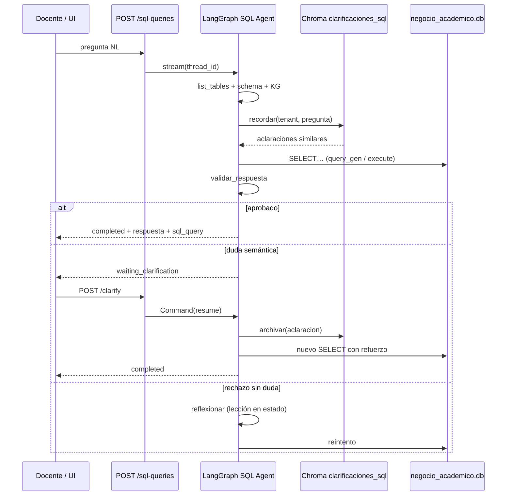

# Pruebas del SQL Agent — Reflexión, Knowledge Graph y refuerzo en Chroma

**Fecha de campañas:** 2026-11-03  
**Proyecto LangSmith:** `orquestacion-agentes-educacion`  
**BD de negocio:** `data/negocio_academico.db` (sintética académica, 500 estudiantes, notas 0–10)  
**Entornos corroborados:** local (`docker compose`, `:8000`/`:8501`) y producción (`146.190.151.125`)

Este documento evidencia las pruebas de consumo del **agente de bases de datos** (SQL Agent), los ajustes introducidos (grafo de conocimiento, reflexión/validación, HITL, persistencia Chroma) y **cómo el refuerzo se usa en tiempo de consulta**.

Artefactos crudos: `storage/metrics/consulta-*.json`, `storage/metrics/sql-agent-pipeline.json`, `storage/metrics/suspendidos-2023-2024.csv`.  
Pipeline automático: [resultados-sql-agent-pipeline.md](resultados-sql-agent-pipeline.md).

---

## 1. Objetivo de las pruebas

| Objetivo | Qué se mide |
|---|---|
| Correctitud SQL | ¿El agente consulta las tablas correctas y no inventa datos? |
| Anti-alucinación de esquema | ¿El knowledge graph evita tablas/columnas inexistentes? |
| Reflexión | ¿La validación rechaza respuestas incoherentes y genera lecciones? |
| HITL | ¿Ante duda, pide aclaración humana y reanuda? |
| **Refuerzo (Chroma)** | ¿La aclaración/seed se persiste y se **reinyecta** en la siguiente consulta? |
| Paridad UI/API | ¿Local y producción muestran el mismo grafo y resultados? |

---

## 2. Arquitectura bajo prueba (ajustes implementados)

### 2.1 Topología LangGraph del SQL Agent

```
START → primer_llamado → list_tables_tool → model_get_schema → get_schema_tool
      → cargar_memoria          ← refuerzo Chroma (recordar)
      → query_gen
           ├─ ProponerConsultaSQL → correct_query → execute_query → query_gen
           ├─ SubmitFinalAnswer (sin queries_ok) → exigir_consulta → query_gen
           └─ SubmitFinalAnswer (con evidencia)
                  → validar_respuesta
                       ├─ emitir_respuesta → END
                       ├─ reflexionar → query_gen          ← lección en estado
                       └─ aclaracion_humana (interrupt)    ← HITL
                              → archivar Chroma            ← refuerzo write
                              → query_gen
```

Código: `src/sql_agent/graph.py`, `src/sql_agent/reflexion.py`, `src/memory/clarificaciones_sql.py`.

### 2.2 Tres capas de “aprendizaje / refuerzo”

| Capa | Dónde vive | Cuándo se escribe | Cuándo se lee | Alcance |
|---|---|---|---|---|
| **Knowledge graph** | `data/sintetica_academica/knowledge_graph.json` | Diseño / migración | Cada `query_gen` (system prompt) | Global (esquema) |
| **Lecciones de Reflexion** | Estado LangGraph `lecciones[]` | Tras `validar_respuesta` rechazado → nodo `reflexionar` | Siguiente `query_gen` de **la misma** petición | Ephemeral (1 request) |
| **Aclaraciones Chroma** | Colección `clarificaciones_sql_<modelo>` en `storage/chroma` | Seed canónico o HITL `aclaracion_humana` | Nodo `cargar_memoria` al inicio (y tras HITL en la misma sesión) | Por `tenant` (= `user_id` docente) |

Umbral de recall: `UMBRAL_MEMORIA_SQL` (default `0.70`, similitud coseno).

### 2.3 Qué hace el refuerzo Chroma al **consumir** el agente

1. El docente envía una pregunta (`POST /sql-queries`).
2. Tras obtener el schema, el nodo **`cargar_memoria`** embebe la pregunta y consulta Chroma filtrando `tenant`.
3. Si hay hits ≥ umbral, se inyectan en el system prompt como bloque:

```text
ACLARACIONES APRENDIDAS (cúmplelas; vienen de docentes / casos canónicos):
Petición parecida: …
Aclaración: …
Lección: …
SQL correcto (pista): …
```

4. El LLM debe obedecer esas pistas al generar SQL (también reforzado por reglas del KG, p. ej. «año pasado ≠ `anio_ingreso`»).
5. Si más adelante hay HITL, `archivar(...)` escribe un nuevo vector; la **siguiente** consulta similar del mismo docente ya parte con ese conocimiento.

Semillas desplegadas: `scripts/seed_clarificacion_sql_anio_pasado.py` y `scripts/seed_clarificaciones_sql_docentes.py` (post-`remote.sh deploy` / `docker exec`).

---

## 3. Baseline: error antes de los ajustes

### Caso «matriculados el año pasado» (sin reflexión + sin seed)

| Campo | Valor |
|---|---|
| Pregunta | ¿Cuáles son los estudiantes que se matricularon el año pasado? |
| SQL erróneo | `WHERE e.anio_ingreso = 2022` |
| Respuesta | 83 estudiantes (cohorte de **ingreso**, no matrícula del periodo) |
| Evidencia | `storage/metrics/consulta-matriculas-anio-pasado.json` |
| Traza LangSmith (primera corrida) | Proyecto `orquestacion-agentes-educacion`, run `sql-agent-matriculas-anio-pasado-…` |

**Diagnóstico:** confusión semántica `anio_ingreso` vs periodo vía `matriculas→ofertas→periodos`.  
**Ground truth periodo vigente `2024-2025`:** 500 estudiantes matriculados.

Este caso motivó: regla en KG, validador determinista, seed Chroma y nodo `cargar_memoria`.

---

## 4. Pipeline automático (PASS)

Regenerado: `python scripts/run_sql_agent_pipeline.py --write-doc`  
Snapshot: [resultados-sql-agent-pipeline.md](resultados-sql-agent-pipeline.md) · `storage/metrics/sql-agent-pipeline.json`

| Check | Resultado | Evidencia de ajuste |
|---|---|---|
| `knowledge_graph` | ✅ 11 entidades / 15 relaciones | KG cargado |
| `kg_regla_anio_pasado` | ✅ | Regla temporal en prompt |
| `seed_clarificacion_chroma` | ✅ hits=2 | Refuerzo persistido y recuperable |
| `agent_top10` | ✅ EST-0476 · 8.94 (2023-2024) | SQL + ranking |
| `agent_paralelo` | ✅ paralelo B · ~7.00 | JOINs correctos |
| `agent_anio_pasado` | ✅ periodo **2024-2025**, `sql_forbid=anio_ingreso` | **Aprendizaje aplicado** |
| `agent_fuera_esquema` | ✅ no inventa (corta / declara límite) | Anti-alucinación |

---

## 5. Campaña de consultas manuales + LangSmith

Todas en el proyecto LangSmith `orquestacion-agentes-educacion`.

### 5.1 Resumen ejecutivo

| # | Caso | t (s) | LangSmith | Resultado | Mecanismos observados |
|---|---|---|---|---|---|
| A | Matrículas «año pasado» (baseline) | ~10 | run `…matriculas-anio-pasado…` | ❌ 83 vía `anio_ingreso` | Sin refuerzo |
| B | Quinto curso vigente | 35.7 | [01a1a210-…](https://smith.langchain.com/o/4a55e1a8-8d3b-499d-9b9c-e8b93883ea41/projects/p/f75e76eb-ae52-4054-abf5-fd5b2f7fe249/r/01a1a210-aa8c-76e3-9803-d9c5af57a69c?poll=true) | ✅ EST-0080 Paula Soto Jiménez · 8.91 | HITL + reflexionar + Chroma write |
| C | Top 5 Psicología vigente | 15.1 | [01a1a21a-…](https://smith.langchain.com/o/4a55e1a8-8d3b-499d-9b9c-e8b93883ea41/projects/p/f75e76eb-ae52-4054-abf5-fd5b2f7fe249/r/01a1a21a-fa34-7780-97d0-bd567cc00417?poll=true) | ✅ Paula #1 · 8.91 | `cargar_memoria` → validar → emitir |
| D | Suspendidos año anterior | 62.2 | [01a1a221-…](https://smith.langchain.com/o/4a55e1a8-8d3b-499d-9b9c-e8b93883ea41/projects/p/f75e76eb-ae52-4054-abf5-fd5b2f7fe249/r/01a1a221-653d-76f3-9726-be7640fa20b5?poll=true) | ⚠️ listado OK pero periodo **vigente** | Validación aprobó; gap semántico «anterior» |
| E | Récord Ana Benítez Ortiz | 70.3 | [01a1a224-…](https://smith.langchain.com/o/4a55e1a8-8d3b-499d-9b9c-e8b93883ea41/projects/p/f75e76eb-ae52-4054-abf5-fd5b2f7fe249/r/01a1a224-c3be-7343-87b6-41f017dcc700?poll=true) | ⚠️ datos en BD OK; agente → `retry_agotado` | HITL + reflexión; informe final incompleto |

### 5.2 Caso B — Quinto curso (evidencia de HITL + refuerzo)

**Pregunta:** estudiante de quinto curso con mejores notas en el año escolar vigente.

**Camino LangGraph (LangSmith):**

1. Exploración schema + `cargar_memoria`
2. SQL con cohorte quinto; validación **rechaza** / pide aclaración
3. **`aclaracion_humana`** (interrupt) — pregunta: periodo vigente vs cohorte
4. Aclaración inyectada: `anio_ingreso = anio_inicio_vigente − 4`; ranking por `promedios_periodo`
5. **`archivar` en Chroma** (tenant de la sesión)
6. `reflexionar` genera lección en estado
7. Reintento SQL → `validar_respuesta` **aprobado** → `emitir_respuesta`

**Ground truth BD:**

| Código | Nombre | Carrera | Periodo | Promedio | Ingreso |
|---|---|---|---|---|---|
| EST-0080 | Paula Soto Jiménez | PSI | 2024-2025 | 8.91 | 2020 |

**Lecciones en estado (2):** aclaración humana + plan SQL del Reflector  
Archivo: `storage/metrics/consulta-quinto-curso-vigente.json`

### 5.3 Caso C — Top 5 Psicología (consumo “feliz” con memoria)

**Camino:**  
`primer_llamado → … → cargar_memoria → query_gen ⇄ execute → validar_respuesta → emitir_respuesta`  
(~15 s, sin HITL)

| # | Código | Nombre | Periodo | Promedio |
|---|---|---|---|---|
| 1 | EST-0080 | Paula Soto Jiménez | 2024-2025 | 8.91 |
| 2 | EST-0175 | María Silva Salazar | 2024-2025 | 8.43 |
| 3 | EST-0260 | Joaquín Gómez Herrera | 2024-2025 | 8.43 |
| 4 | EST-0355 | Sofía Castro Quintero | 2024-2025 | 8.377 |
| 5 | EST-0115 | Lucía Díaz Díaz | 2024-2025 | 8.367 |

Veredicto: `aprobado=true`. Coincide con SQL directo.

### 5.4 Caso D — Suspendidos «año anterior» (validación vs semántica)

- Criterio usado: `nota < 5.0`
- El agente listó **159** filas ordenadas alfabéticamente y la validación **aprobó**
- El SQL usó `anio_fin = MAX(anio_fin)` → **vigente 2024-2025**, no `MAX−1` → **2023-2024**
- Corrección humana / ground truth: **145** filas, **119** estudiantes → `storage/metrics/suspendidos-2023-2024.csv`

**Lección de evaluación:** la reflexión actual detecta bien `anio_ingreso` vs matrícula, pero aún no tiene regla determinista fuerte para «año anterior» vs «vigente». Candidato a extender `verificar_respuesta` / seed Chroma «año anterior = MAX(anio_fin)−1».

### 5.5 Caso E — Récord Ana Benítez Ortiz

- HITL + varios ciclos; finalmente `retry_agotado`
- BD (fuente de verdad) — ficha EST-0038, ADM, ingreso 2020, paralelo B
- Promedios: 7.27 → 6.73 → 6.00 → 5.90 → **7.68** (2024-2025)
- 24 calificaciones; suspensos (&lt;5): Ética 4.75 (2022-2023), Inglés 3.50 (2023-2024)

Evidencia: `storage/metrics/consulta-record-ana-benitez.json` + traza LangSmith enlazada arriba.

---

## 6. Evidencia del refuerzo Chroma (lectura + escritura)

### 6.1 Escritura (write path)

| Evento | API / nodo | Persistencia |
|---|---|---|
| Seed canónico «año pasado» | `seed_anio_pasado(tenant)` | `clarificaciones_sql_<embedding_model>` |
| Seed docentes post-deploy | `scripts/seed_clarificaciones_sql_docentes.py` | tenant=`user_id` de cada docente |
| HITL docente | Nodo `aclaracion_humana` tras `POST /sql-queries/{id}/clarify` | `archivar(tenant, pregunta, aclaracion, leccion=…)` |

Producción (2026-11-03): seed OK para `tenant=1` (demo) y `pipeline-sintetica`.

### 6.2 Lectura (read path al consumir)

En **cada** consulta:

1. Nodo `cargar_memoria` → `recordar(tenant, pregunta, k=3)`
2. Hits con coseno ≥ `UMBRAL_MEMORIA_SQL` se concatenan al system prompt (`bloque_memoria`)
3. Pipeline midió `seed_clarificacion_chroma` con **hits=2** y el caso `agent_anio_pasado` pasó el forbid `anio_ingreso`

### 6.3 Diagrama del ciclo de refuerzo



### 6.4 Qué ve el usuario en la UI

Página **Consultas SQL** (`app_streamlit/pages/5_Consultas_SQL.py`):

- Ejemplos alineados a estas pruebas
- Estado `waiting_clarification` con motivos, borrador y SQL propuesto
- Aclaraciones rápidas (año pasado / suspendido / quinto curso)
- Expander **Pasos del agente (LangGraph)** con veredicto y lecciones (misma información que alimenta LangSmith)

---

## 7. Paridad local vs producción

| Chequeo | Local | Producción |
|---|---|---|
| Health `sql_agent` | `configured=true`, dialect `sqlite` | igual |
| UI | http://localhost:8501 | http://146.190.151.125:8501 |
| API | http://localhost:8000 | http://146.190.151.125:8000 |
| Pregunta top 5 PSI | EST-0080 Paula · 8.91 | EST-0080 Paula · 8.91 |
| Nodos grafo | `…cargar_memoria…validar_respuesta→emitir_respuesta` | idéntico |
| Seed Chroma docentes | `OK=2/2` | `OK=2/2` |

Demo: `demo@instituto.local` / `demo1234`.

---

## 8. Evaluación de comportamiento (síntesis)

### 8.1 Qué mejoró con los ajustes

1. **Knowledge graph:** contexto estable de 11 tablas + reglas (escala 0–10, JOINs, anti-tablas legado).
2. **Validación + Reflexion:** cierra el loop Actor–Evaluador–Reflector como en exámenes (`src/orchestrator/reflexion.py`).
3. **HITL de aclaración:** evita cerrar con filtros ambiguos; deja traza `waiting_clarification` / `aclaracion_recibida`.
4. **Chroma de refuerzo:** convierte aclaraciones (y seeds) en memoria recuperable por similitud → el consumo posterior **no parte de cero**.
5. **Evidencia empírica:** `agent_anio_pasado` del pipeline pasa de 83/`anio_ingreso` a listado por periodo vigente sin esa columna.

### 8.2 Limitaciones observadas (honestidad experimental)

| Limitación | Evidencia | Mejora sugerida |
|---|---|---|
| «Año anterior» ≠ «vigente» no siempre se corrige | Caso D aprobó SQL con `MAX(anio_fin)` | Regla determinista + seed Chroma |
| Informes largos multi-query agotan reintentos | Caso E `retry_agotado` | Planificar subconsultas / subir límite / resumen incremental |
| Validación LLM puede aprobar prosa con periodo mal etiquetado | Caso B texto «2020-2021» vs SQL 2024-2025 | Check determinista: `periodos.codigo` en respuesta ⊆ resultado SQL |
| `fuera_esquema` a veces cae en `retry_agotado` | Pipeline preview | Cortocircuito tras N fallos “sin tablas” |

### 8.3 Criterios de aceptación usados

- Al menos una `db_query_tool` exitosa antes de aceptar respuesta (`queries_ok`)
- Solo SELECT (AST + executor)
- Prohibición de `anio_ingreso` en preguntas de matrícula temporal relativa (determinista + seed)
- Persistencia Chroma fail-soft (si falla embeddings, no tumba la consulta)

---

## 9. Cómo reproducir la evidencia

```bash
# BD + KG
python scripts/generar_sintetica_academica.py
python scripts/migrar_sintetica_academica.py

# Refuerzo Chroma
python scripts/seed_clarificaciones_sql_docentes.py --also-tenant pipeline-sintetica

# Pipeline + doc corta
python scripts/run_sql_agent_pipeline.py --write-doc

# UI local
docker compose up -d --build
# http://localhost:8501 → Consultas SQL

# Producción
./scripts/remote.sh deploy
./scripts/remote.sh health
```

LangSmith: activar `LANGCHAIN_TRACING_V2=true` + `LANGCHAIN_API_KEY` + `LANGCHAIN_PROJECT=orquestacion-agentes-educacion`. Las trazas de esta campaña están en los enlaces de la §5.

---

## 10. Referencias de código

| Pieza | Ruta |
|---|---|
| Grafo SQL + nodos reflexión/HITL | `src/sql_agent/graph.py` |
| Validador / prompts reflexión | `src/sql_agent/reflexion.py` |
| KG → system prompt | `src/sql_agent/knowledge_graph.py` |
| Memoria Chroma aclaraciones | `src/memory/clarificaciones_sql.py` |
| API + clarify | `src/api/routers/sql_agent.py`, `src/api/services/sql_agent_runner.py` |
| UI | `app_streamlit/pages/5_Consultas_SQL.py` |
| ER sintética | `docs/diagramas/er-bd-sintetica-academica.jpg` |
| Schema / KG | `data/sintetica_academica/` |

---

*Documento de evidencia experimental del SQL Agent (Reflexion + KG + refuerzo Chroma). Complementa [resultados-sql-agent-pipeline.md](resultados-sql-agent-pipeline.md) y [arquitectura.md](arquitectura.md) §6.5.*
