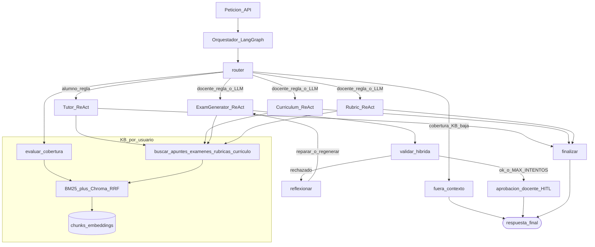
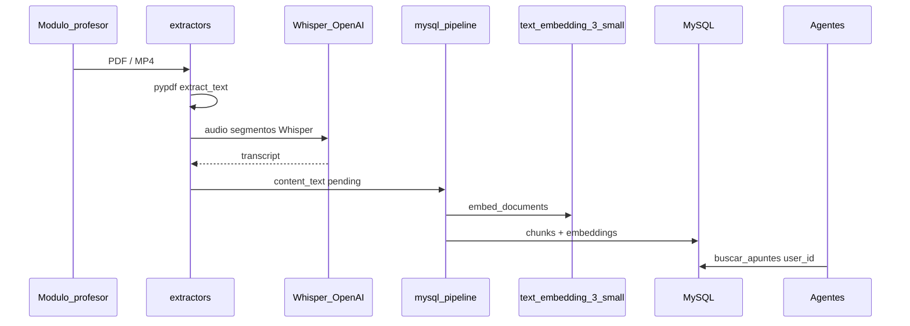

# Revisión de implementación e interacción de agentes

**Generado (UTC):** 2026-11-02T18:48:35.846677+00:00
**Resultado global:** PASS

## 1. Checks

| Check | OK | Detalle |
|---|---|---|
| `model_registry` | ✅ | profile=cloud_openai llm=gpt-4o-mini emb=text-embedding-3-small |
| `ffmpeg` | ✅ | /Users/peluchito/Desktop/Orquestacion-Agentes/.venv/lib/python3.13/site-packages/imageio_ffmpeg/binaries/ffmpeg-macos-x86_64-v7.1 |
| `extractors_modules` | ✅ | pdf/video/module_media/cost_estimate importables |
| `demo_user` | ✅ | id=1 rol=docente |
| `modulo_indexed` | ✅ | 8 docs del módulo; indexed=True |
| `retriever_apuntes` | ✅ | len=4278 t=3.67s |
| `agent:alumno_tutor_finanzas` | ✅ | nodos=['router', 'tutor', 'finalizar'] destino=tutor t=9.16s |
| `agent:docente_curriculum_finanzas` | ✅ | nodos=['router', 'curriculum', 'finalizar'] destino=curriculum t=9.71s |
| `agent:docente_examen_fuera_contexto` | ✅ | nodos=['router', 'fuera_contexto'] destino=fuera_contexto t=4.2s |

> Instantánea generada por `scripts/review_agents_pipeline.py --write-doc`. Incluye Guardrails de cobertura KB (`fuera_contexto`). Diseño: [arquitectura.md](arquitectura.md).

## 2. Flujo de agentes (implementación + Guardrails)



## 3. Pipeline de medios (PDF / vídeo)



## 4. Trazas de esta corrida

### `alumno_tutor_finanzas`
- Nodos: `['router', 'tutor', 'finalizar']`
- Destino: `tutor`
- Cobertura KB: `{'suficiente': True, 'score': 0.5555555555555556, 'motivo': 'sem=0.27 lex=0.56 (umbral_sem=0.38, lex>=0.20 o sem>=0.55)', 'fuentes': ['27d6253cb1_Guía didáctica.pdf', '923ca4cc1d_GMT20251122-001420_Recording_1686x768.mp4', 'tecnologia_3eso_curriculo.txt']}`
- Preview: En el contexto de Finanzas Estratégicas, es importante entender la diferencia entre costo de operación y costo de producción.  ### Costo de Producción El costo de producción se refiere a todos los gastos que se incurren para fabricar un producto. Esto incluye tanto los costos directos como los indirectos. Los costos directos son aquellos que se pueden atribuir directamente a la producción de un bi

### `docente_curriculum_finanzas`
- Nodos: `['router', 'curriculum', 'finalizar']`
- Destino: `curriculum`
- Cobertura KB: `{'suficiente': True, 'score': 0.5833333333333334, 'motivo': 'sem=0.42 lex=0.58 (umbral_sem=0.38, lex>=0.20 o sem>=0.55)', 'fuentes': ['tecnologia_3eso_curriculo.txt', '27d6253cb1_Guía didáctica.pdf', '8a26203578_GMT20251008-003001_Recording_1686x768.mp4', '05e544ab6b_GMT20251115-000945_Recording_1686x728.mp4']}`
- Preview: Aquí tienes una propuesta de programación didáctica para una unidad introductoria de Finanzas Estratégicas, estructurada en 4 sesiones:  ### Unidad: Introducción a las Finanzas Estratégicas  #### Sesión 1: Conceptos Básicos de Finanzas - **Objetivo:** Comprender los conceptos fundamentales de las finanzas y su importancia en la toma de decisiones empresariales. - **Contenidos:**   - Definición de 

### `docente_examen_fuera_contexto`
- Nodos: `['router', 'fuera_contexto']`
- Destino: `fuera_contexto`
- Guardrail: petición fuera de contexto esperada
- Cobertura KB: `{'suficiente': False, 'score': 0.3592008352279663, 'motivo': 'sem=0.36 lex=0.14 insuficiente (tema no respaldado por la KB de la sesión)', 'fuentes': ['27d6253cb1_Guía didáctica.pdf', 'tecnologia_3eso_2024_electricidad.txt', 'tecnologia_3eso_2023_electricidad.txt', 'tecnologia_3eso_rubrica_examenes.txt']}`
- Preview: No puedo atender esta petición con el material de la sesión actual: no hay evidencia suficiente en la base documental vectorial asociada a tu usuario. Reformula la consulta usando temas, conceptos o unidades que figuren en tus apuntes, exámenes, rúbricas o currículo cargados. No inventaré contenido ajeno a esa documentación. (sem=0.36 lex=0.14 insuficiente (tema no respaldado por la KB de la sesió

## 5. Cómo reproducir

```bash
python scripts/transcribe_and_index_module.py  # si el módulo aún no está indexado
python scripts/review_agents_pipeline.py --write-doc
```

El escenario `docente_examen_fuera_contexto` comprueba que Guardrails bloquea temas ajenos a la KB (p. ej. Renacimiento) sin inventar un examen.
